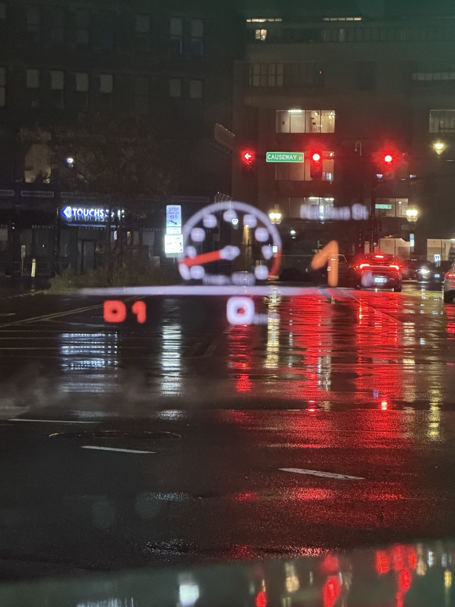

# CarPlay map on the cluster + OEM turn arrows on the HUD — Porsche 971 / PCM 4.1

Puts the **Apple Maps / CarPlay navigation map on the instrument cluster** of a
Porsche Panamera (971) with PCM 4.1 (Harman MHI2 High), and drives the car's
**own factory turn-arrow graphics on the HUD and cluster from the CarPlay
route**, using the stock Porsche navigation BAP path.



*The car's own HUD turn arrow — the data comes from Apple Maps over CarPlay, the graphics are the stock Porsche HUD.*

Two independent pieces, each useful on its own:

| Piece | What it does | Where it runs |
|---|---|---|
| **Cluster map** | a second, iPhone-rendered CarPlay map video on the right cluster screen | `LD_PRELOAD` hook in `dio_manager` |
| **HUD arrows** | feeds maneuver / distance / street into the stock navigation BAP service, so the factory arrow graphics appear on the HUD and cluster | shadow Java class in the HMI |

It is **not** a mirror of the centre screen. The head unit advertises a second
display (altScreen, stream type 111) to the iPhone, the phone encodes a
dedicated 800×480 H.264 stream for it, and the head unit decodes and composites
it on the cluster. The HUD arrows are the real OEM graphics — nothing is drawn
by this project, it only supplies the data the cluster already knows how to
render.

---

## ⚠️ Read before installing

- **One firmware only.** Developed and verified on exactly one car:
  **`MHI2_US_POG24`, build MU1416, HW 055**. The memory offsets and the BAP
  function codes were read from *this* build. On any other train (MU1476,
  MU1417, Audi K2161, …) the addresses differ and it can break CarPlay or worse.
  **The installer refuses to run on a non-matching firmware.**
- **Your own car, at your own risk.** Everything here is reversible and
  file-level — no flash, IFS, EEPROM, FEC, coding or Component Protection is
  touched — but it is still a modification, and extended warranty is a real
  consideration.
- **No warranty of any kind.** See [LICENSE](LICENSE).

## What works (verified on the car)

- CarPlay map on the cluster, 800×480, 30 fps.
- Centre-screen CarPlay unaffected and running at the same time.
- Automatic switchover: cluster shows the CarPlay map while it is flowing, and
  returns to the stock Porsche map on disconnect.
- With a route active in Apple Maps, the cluster keeps the **map** (not the
  full-screen grey turn card) and the **factory arrow** appears on the HUD and
  cluster with the maneuver, distance and street name, counting down and
  updating per maneuver.
- Reversible: a kill switch with no laptop (`echo 0 > /tmp/hook_level`), and a
  full uninstall that restores the one changed config line.

## How it works

```
iPhone ──iAP2/USB──► PCM
  │  CarPlay cluster video (stream 111) ─► dio_manager hook ─► NvSS ─► cluster
  │  route guidance ────────────────────► (feeder) ─► /tmp/hud_cmd
  ▼                                                      │
Apple Maps route                                         ▼
                                     HUD bridge (HMI shadow class)
                                     ─► stock CombiBAPServiceNavi
                                     ─► factory arrow on HUD + cluster
```

- **Cluster map** — `hook/carplay_hook.c`, an `LD_PRELOAD` library in
  `dio_manager`. It rewrites the control-SETUP response to enable `altScreen`,
  injects a second display into `/info`, receives and AES-CTR decrypts the
  stream, and feeds it to a second `dio::NvssVideoImpl` aimed at the cluster
  layer. The cluster **scene** is pinned to map-only via `initialURL`; the hook
  does **not** answer the phone's `suggestUI` (that is what used to flip the
  cluster to a full-screen turn card).
- **HUD arrows** — `hud/`, a Java class that shadows the stock
  `de.audi.app.combi.bap.app.navi.ServiceManagerNavi` (identical behaviour plus
  one call) and hands the live `AppConnectorNavi` to `de.carplay.hud.HudBridge`.
  The bridge reads one-line commands from `/tmp/hud_cmd` and calls the stock
  `CombiBAPServiceNavi` (`updateRGStatus` / `updateManeuverDescriptor` /
  `updateDistanceToNextManeuver` / `updateTurnToInfo` / `updateExitView`), with
  BAP function synchronisation so the arrow appears immediately. Anything shown
  auto-clears after 60 s with no new command, and `/tmp/hud_bridge_off` disables
  it.

See [docs/ARCHITECTURE.md](docs/ARCHITECTURE.md) and
[docs/FINDINGS.md](docs/FINDINGS.md) for the detail and the reverse-engineering
notes.

### The HUD-arrow input (route guidance)

The HUD bridge is the **output** half and is complete. The **input** half — the
feeder that reads iAP2 Route Guidance from the phone and writes `TURN` / `DIST`
/ `STOP` to `/tmp/hud_cmd` — lives in `mm-ipod` and is **not** included in this
repository (third-party-derived and firmware-specific). The bridge is documented
so any feeder can drive it; see [hud/README](hud). You can test the arrows
without it:

```sh
echo "TURN 13 192 300 ft Main St" > /tmp/hud_cmd   # turn right in 300 ft
echo "DIST 150 ft"               > /tmp/hud_cmd    # countdown
echo "STOP"                      > /tmp/hud_cmd    # clear
```

## Install

Requires a M.I.B. (More Incredible Bash) SD card and root access to the PCM.
See [install/README.md](install/README.md). In short: copy `install/` onto the
M.I.B. SD as `/mod/`, run **Main → M.I.B. → Advanced Settings → Run Custom
Script**, and reboot the PCM once.

## Uninstall

`install/uninstall.sh` (or the M.I.B. menu entry) removes the library and the
jar and restores the stock `smartphone_integrator.json`. Reboot the PCM.

## Credits

Standalone reverse-engineering on the owner's own car. Builds on the published
work of the Porsche / MHI2 CarPlay-cluster community — CorsairCat, luka-dev,
edzenis, fifthBro and others. See [NOTICE.md](NOTICE.md).
